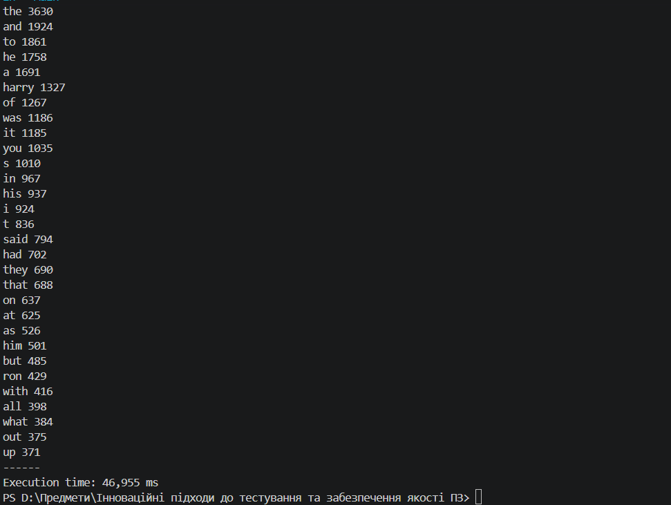
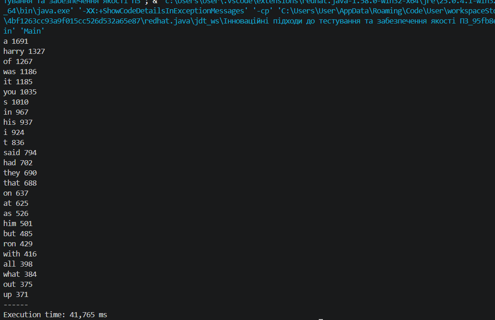

Оптимізація часу виконання програми

За основу взято попередній проєкт на Java, призначений для підрахунку частоти слів у текстовому файлі та виведення найчастіше вживаних слів.

Для оптимізації швидкодії змінено спосіб обробки тексту. Замість регулярних виразів і створення масивів слів реалізовано посимвольну обробку за допомогою StringBuilder. Для підрахунку частоти слів використовується HashMap, а для вибору найчастіших слів — PriorityQueue, що дає змогу уникнути повного сортування всіх унікальних слів.

Час виконання оптимізованої програми вимірюється за допомогою System.nanoTime(). Після запуску програма виводить найчастіше вживані слова та час виконання.

Для оцінювання результатів проведено запуск початкової й оптимізованої версій на тому самому текстовому файлі. Результати виконання та вимірювання часу наведено на скриншотах.

Початкова версія програми:

Оптимізована версія програми:

